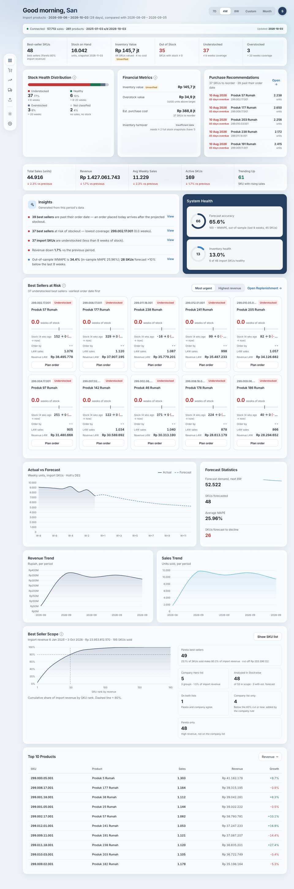
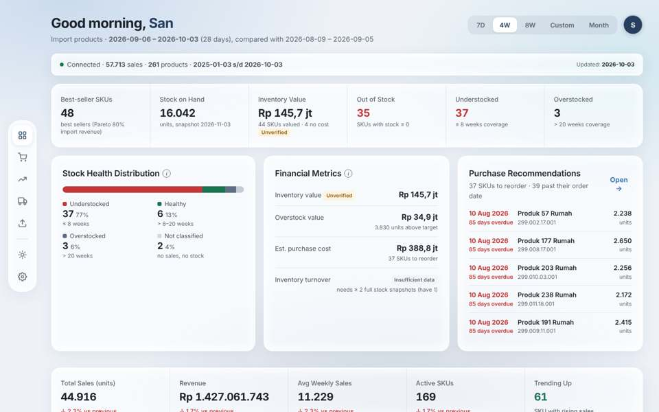
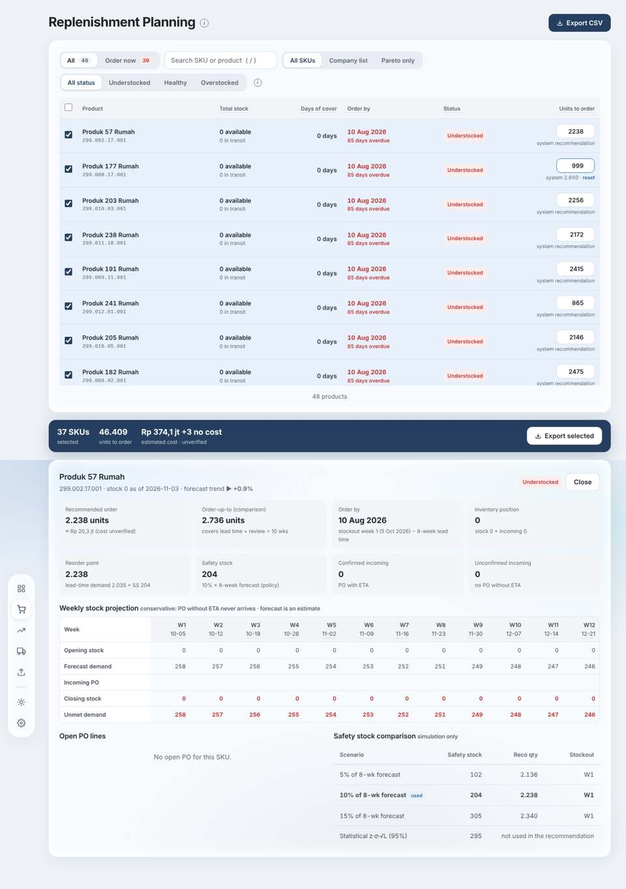
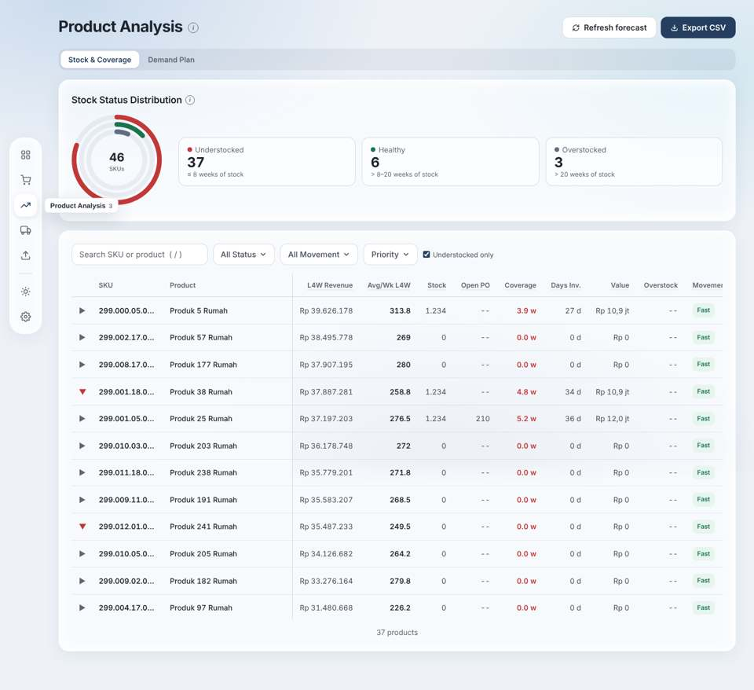
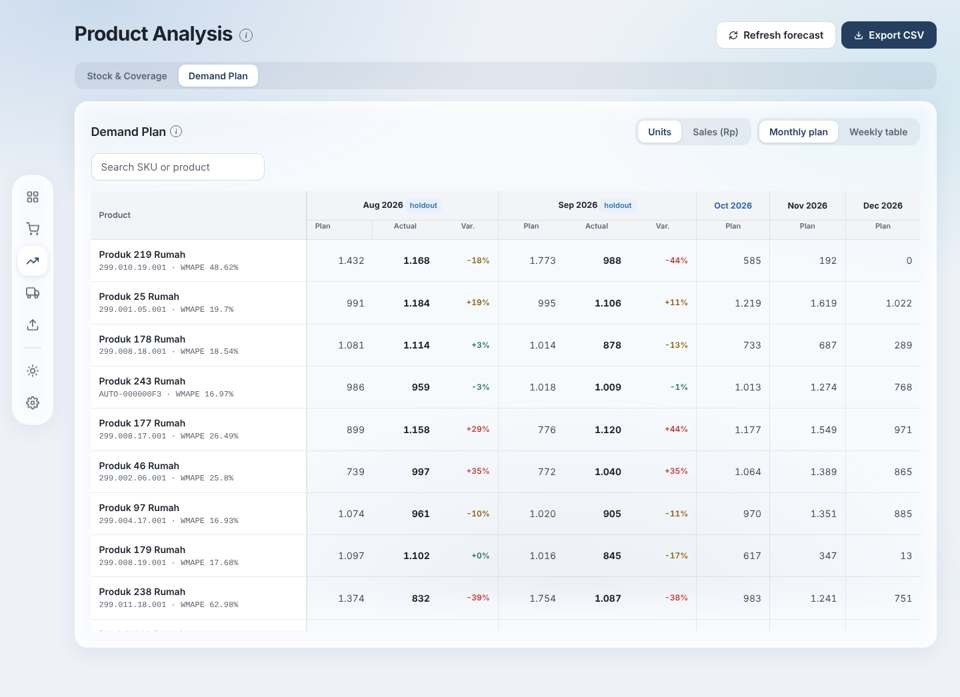
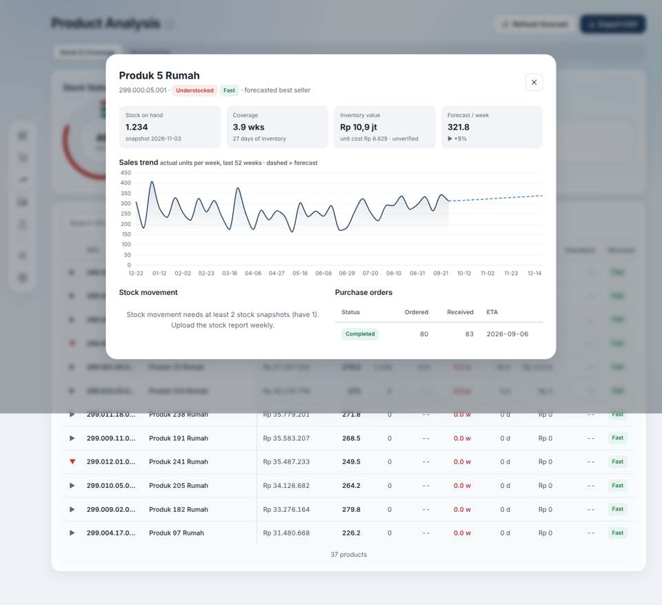
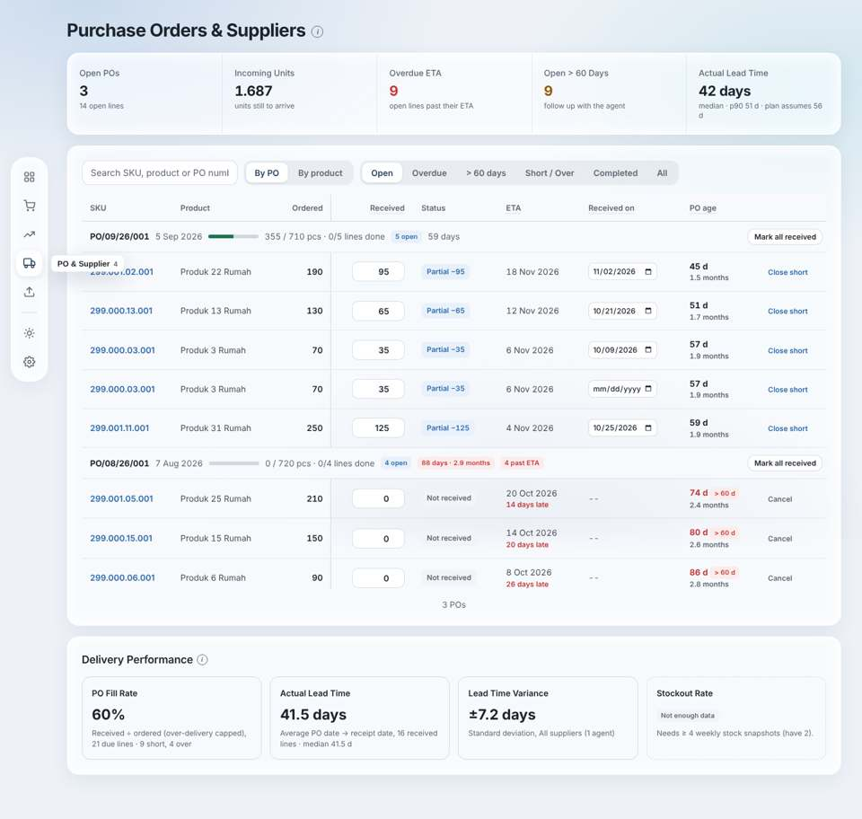
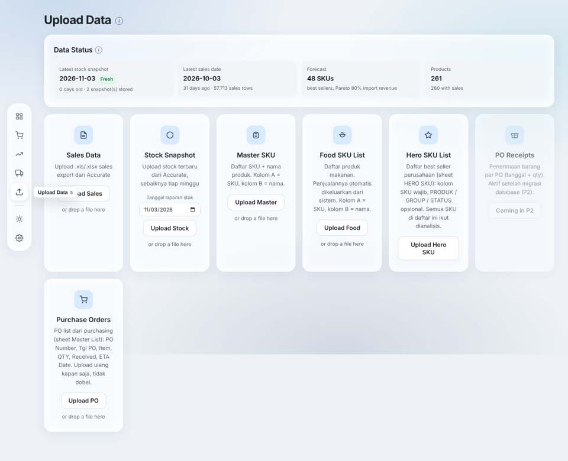

# Phase 5 — Stage 1: UI/UX Audit

Stockwise as deployed on `main@08fca67` (2026-11-03). Evidence: screenshots from the Phase 4 browser regression
run (`tests/e2e`, 1440 × 900 desktop unless noted) on the **synthetic test data set** — product names
("Produk 57 Rumah") and values are fake; layout, components and behaviour are the real application. Facts about
behaviour were checked in the code (`static/js/pages/*.js`) and in the recorded API calls.

Primary user: purchasing staff. Main daily question: *which SKUs do I need to order, how many, and by when?*

---

## 0. Cross-cutting findings

| # | Finding | Evidence |
|---|---|---|
| X1 | **Navigation is icon-only.** Five page icons + theme + settings, labels only as hover tooltips or keyboard numbers 1–5. A new user cannot tell "PO & Supplier" from "Upload" without hovering. | sidebar in every screenshot |
| X2 | **Three date formats on one screen**: `2026-11-03`, `10 Aug 2026`, `11/02/2026` (browser date input). | Overview header, Replenishment, PO page |
| X3 | **Mixed languages**: UI in English, upload instructions and some messages in Indonesian ("Upload stock terbaru dari Accurate…"). | Upload page |
| X4 | **Status colours are mostly paired with a label** (Understocked/Healthy/Overstocked chips) — good. Exceptions: red numbers for coverage and order-by dates without text; health bar segments without labels (legend separate). | Overview, Product Analysis |
| X5 | **Denominators differ between pages.** Overview "Best-seller SKUs 48" (incl. 2 "not classified"); Product Analysis donut "46 SKUs" (excludes them); Replenishment "All 48". Same data, three totals without explanation. | Overview, Product Analysis, Replenishment |
| X6 | **"Updated" is ambiguous.** Overview shows "Updated: 2026-10-03" (last sales date) while the stock snapshot is 2026-11-03; users read it as "data is a month old". | Overview header |
| X7 | **Glass surfaces everywhere** (cards, risk cards, tiles inside cards, modals). Nested rounded boxes inside rounded boxes add visual noise and make hierarchy flat. | all pages |
| X8 | Good existing patterns to keep: freshness banners, "Not enough data" instead of 0, info (i) tooltips with definitions, skeleton loading, toasts, keyboard shortcuts, editable quantities with "system recommendation / reset". | various |

## 1. Overview

**Main user objective:** see in seconds whether anything needs purchasing action today.

**Current hierarchy (top → bottom, 12 blocks, 4,346 px tall = 4.8 screens at 1440 × 900; 10,524 px on a 390 px phone):**
greeting + period filter → connection bar → inventory KPI strip (6) → Stock Health · Financial Metrics · Purchase
Recommendations → sales KPI strip (5) → Insights · System Health → Best Sellers at Risk (10 cards) → Actual vs
Forecast + Forecast Statistics → Revenue Trend · Sales Trend → Best Seller Scope (Pareto chart + 6 tiles) → Top 10
Products.

| Problem | Detail |
|---|---|
| **No single "what needs attention" answer above the fold.** | The only action-oriented block (Purchase Recommendations, 5 rows) is the third card in row 2, same weight as "Financial Metrics". |
| **The same signal is repeated 4–5 times.** | "37 understocked" appears in the KPI strip, Stock Health, Insights (twice), the Best-Sellers-at-Risk subtitle and System Health (as 13% healthy). "Past order date" appears in Purchase Recommendations and Insights. |
| **The period filter looks global but is not.** | Changing 4W → 8W changes only the sales strip, the two trend charts, Top 10 and one insight line (verified: 38 of 322 text lines change; inventory status, recommendations and risk cards do not, they are always "latest snapshot"). |
| **Sales analytics dominate the page.** | Sales KPI strip, Revenue Trend, Sales Trend, Top 10 by revenue, Pareto chart: ~45 % of the page answers "how are sales?", not "what to buy?". |
| **Forecast accuracy is shown in conflicting ways.** | System Health "Forecast accuracy 65.6 % = 100 − WMAPE"; Forecast Statistics "Average MAPE 25.96 %"; Insights "Out-of-sample WMAPE 34.4 % (in-sample MAPE 25.96 %)". Three numbers, two framings; the "accuracy %" framing is not valid (see `docs/forecast-accuracy.md` §2 A7). The chart is labelled "Holt's DES" (method-specific while the method is under review). |
| **Best Sellers at Risk = 10 near-identical cards.** | Each card repeats 8 fields; values truncate ("152 → 0 (…"); comparing SKUs needs eye movement across cards. A sorted list does this job better. |
| **Admin information on the decision page.** | Connection bar (sales rows, product count, date range) and Best Seller Scope (how the SKU set was chosen) are data-management context. San (2026-11-03): Pareto / company-list split is not a feature to surface; Pareto logic to be discussed later. |
| Missing feedback | Period buttons have no loading state on the parts that change; "Open →" on Purchase Recommendations goes to Replenishment without carrying the filter. |

Opportunities: one compact health line, an Action Center with counts and the top SKUs per bucket, one forecast
context line (method-neutral), everything sales-historical moved to Product Analysis.

## 2. Replenishment Planning

**Main user objective:** decide per SKU whether to order and how many; export the list for the PO made in Accurate.

**Current hierarchy:** title + Export CSV → tabs All / Order now · search · source filter (All SKUs / Company list /
Pareto only) · status filter → table (Product, Total stock, Days of cover, Order by, Status, Units to order
editable) → selection bar (SKUs, units, cost, Export selected) → detail panel **below** the table.

| Problem | Detail |
|---|---|
| **Detail opens far from the row.** | Clicking a row renders the detail under the whole table (inner scroll + page scroll); the user loses the list. |
| **No demand context in the list.** | Weekly demand / forecast is only in the detail, so "why 2,238 units?" needs a click per SKU. |
| **Detail mixes operational and analytical content.** | 8 metric tiles incl. "Order-up-to (comparison)" and "Unconfirmed incoming", a 12-week projection table, and a "Safety stock comparison — simulation only" table. Useful for the thesis, noise for the daily decision. |
| **Source filter (Company list / Pareto only).** | San: not needed — use All SKUs only; keep the data, remove the filter. |
| **Selection semantics unclear.** | Every SKU that needs an order with a quantity > 0 is pre-selected (code: `sel = needOrder && reco_po > 0`), without saying so; the selection bar is the only place showing total units and cost, and it appears only after scrolling. |
| **Nested scroll.** | The table has its own max-height scroll inside a page that also scrolls. |
| Good, keep | Order-by date with "days overdue", editable quantity with "system recommendation / reset", status chip with text, export. |

Decision states: the system has **no Order / Hold / Monitor state**. San (2026-11-03): keep Replenishment as it is
functionally — no new decision feature.

## 3. Product Analysis

**Main user objective:** investigate one SKU or the portfolio when the recommendation needs context.

| Problem | Detail |
|---|---|
| **Stock & Coverage duplicates other pages.** | Status donut (= Overview Stock Health) and a 12-column table whose status/coverage columns repeat Replenishment. |
| **Table overflows at 1440 px.** | 12 columns; "Movement" is cut and needs horizontal scroll on the main desktop size. |
| **Two overlapping filters.** | "All Status" dropdown + "Understocked only" checkbox (checked by default) — the dropdown says All while only understocked rows show. |
| **Admin action in an analysis page.** | "Refresh forecast" (recomputes the whole forecast) sits next to Export on this page. |
| **No SKU-first entry point.** | The SKU drawer (sales trend chart, stock, coverage, POs) is good but reachable only by finding the row in a long table; no "back to Replenishment" from it. |
| **Demand Plan exposes per-SKU WMAPE and holdout columns.** | Correct and honest, but without explanation users read "WMAPE 48.62 %" as bad/good without a reference (no benchmark shown). |
| Good, keep | SKU drawer content and chart, demand plan monthly/weekly toggle, units/Rp toggle. |

## 4. PO & Supplier

**Main user objective:** see open POs, update received quantities, follow up late / old POs.

| Problem | Detail |
|---|---|
| **Inline edit controls on every row.** | Received qty input, date input and "Close short / Cancel" text actions in every row: dense and easy to mis-click; no confirm or undo for close/cancel. |
| **Date input format differs** (browser `mm/dd/yyyy`) from the rest of the page. | |
| **Supplier dimension is thin.** | Data has one agent; the page title "& Suppliers" promises more than exists. No supplier column. |
| **Status vocabulary is mixed.** | Chips "Partial −95", "Not received", "Completed", plus filters "Overdue", "> 60 days", "Short / Over" — overlapping concepts without one legend. |
| Good, keep | Summary strip (open, incoming units, overdue, > 60 days, lead time), grouping by PO with progress, by-PO / by-product toggle, Mark all received, delivery performance block. |

## 5. Upload Data

**Main user objective:** keep data current (weekly sales + stock; occasionally lists and POs).

| Problem | Detail |
|---|---|
| **Seven equal cards, one is a dead placeholder.** | "PO Receipts — Coming in P2" is disabled and does nothing (violates "no decorative controls"). Weekly tasks (sales, stock) look the same as rare ones (food list, master SKU). |
| **Inconsistent validation.** | Sales has preview → confirm; all others upload immediately with only a result message. |
| **Long instructions inside cards, mixed language.** | Column requirements as running text in Indonesian. |
| **Refresh forecast is not here** (it is on Product Analysis), although it belongs to the data-update routine. | |
| Good, keep | Data Status strip with freshness, drag & drop, stock report date picker, result messages with counts (e.g. Hero upload). |

## 6. Login, settings, theme

Login and settings modal work; dark theme is complete (all components use tokens). The login page renders the hidden
app underneath (page height 2,413 px behind the overlay) — no visible problem, minor cost.

## 7. Summary — what blocks fast decisions

1. The Overview has no clear first answer; the action list competes with ~20 numbers.
2. The same status is repeated in many places with different totals (48 / 46).
3. Filters look global but apply only to part of the page.
4. SKU detail is far from the list and mixes daily and analytical content.
5. Data-management controls (refresh forecast, connection bar, Pareto scope) sit on decision pages.
6. Forecast accuracy is presented with a misleading "accuracy %" and method-specific labels while the method is
   under review.
