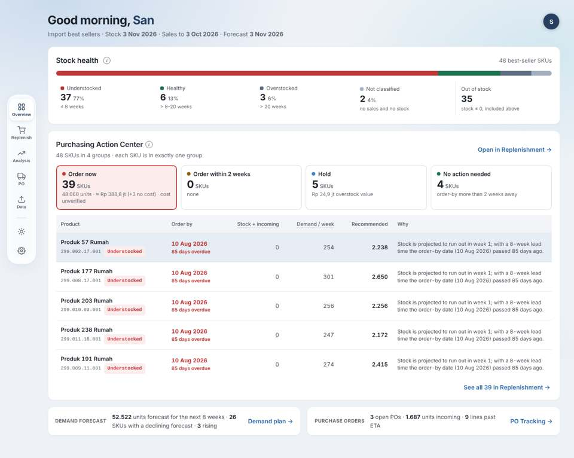

# Phase 5 — UI/UX redesign

| Stage | Document | Status |
|---|---|---|
| 1 Audit | [PHASE_5_UI_UX_AUDIT.md](PHASE_5_UI_UX_AUDIT.md) | done |
| 2 User flow | [PHASE_5_USER_FLOW.md](PHASE_5_USER_FLOW.md) | done |
| 3 Information architecture + decisions A1–A5 | [PHASE_5_INFORMATION_ARCHITECTURE.md](PHASE_5_INFORMATION_ARCHITECTURE.md) | approved 2026-11-03 |
| Design system | [PHASE_5_DESIGN_SYSTEM.md](PHASE_5_DESIGN_SYSTEM.md) | done |
| Implementation | [PHASE_5_IMPLEMENTATION_REPORT.md](PHASE_5_IMPLEMENTATION_REPORT.md) | done on branch `phase5-ux` |
| Regression tests | [PHASE_5_REGRESSION_TEST_REPORT.md](PHASE_5_REGRESSION_TEST_REPORT.md) | done (test data); production check pending |
| Handover for Phase 6 | [PHASE_5_HANDOVER.md](PHASE_5_HANDOVER.md) | done |

Screenshots: `img/current-*` = before (main@08fca67), `img/after-*` = after. All from the synthetic test data set.

